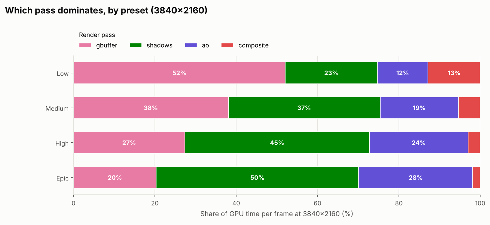

# Game Frame Lab

A frame-time benchmarking and analysis toolkit for GPU performance studies,
and the study it is built for: Unreal Engine 5 (Lyra) and Cyberpunk 2077 on an
NVIDIA RTX 40-series GPU, covering scalability presets, Nsight GPU trace
analysis, DLSS comparisons, and AI inference contention.

The toolkit is developed and tested on machines without an NVIDIA GPU. The
NVIDIA capture path runs on a Windows PC with an RTX 40-series card and has not
been run yet. The macOS capture path runs gflbench, a Metal renderer written for
this project, and has produced the first real results below.

## Results summary

**Apple M3 MacBook Air, gflbench Metal renderer, 36 runs (real measurements).**
Full write-up for readers new to the topic:
[Lab report: how graphics settings change GPU work on an Apple M3](reports/lab_report_apple_m3_scalability.md).



1. **The bottleneck moves with the preset.** At Low, finding surfaces (the
   gbuffer pass) is 52% of GPU time at 4K; at Epic, soft shadows are 50%. The
   split is nearly identical at every resolution.
2. **GPU-bound frame time follows pixel count.** High at 2560x1440 to 3840x2160
   is 2.25x the pixels and took 2.26x longer per frame.
3. **Epic costs 7.1x the GPU time of Low** at 3840x2160 (181.5 ms vs 25.7 ms
   per frame). On this fanless laptop, 4 of 12 configs varied by more than 5%
   between runs and need re-measurement before their numbers are quoted.

The NVIDIA results (Unreal Engine 5, DLSS, inference contention) are still
pending hardware. The sample data in `data/sample/` is synthetic and exists only
to test the code.

## What the study measures

| # | Experiment | Config |
|---|---|---|
| 1 | Lyra Starter Game across 4 scalability presets (Low, Medium, High, Epic) x 3 resolutions (1080p, 1440p, 4K) | `configs/lyra_scalability.yaml` |
| 2 | PresentMon frame times validated against NVIDIA FrameView on the same runs | (all runs) |
| 2b | gflbench, a ray-marched Metal renderer written for this project, across 4 presets x 3 resolutions on Apple silicon, with GPU time per render pass | `configs/metal_scalability.yaml` |
| 3 | DLSS Native, Quality, Balanced, Performance, with Frame Generation on and off, at 1440p and 4K, in Lyra and Cyberpunk 2077 | `configs/lyra_dlss.yaml`, `configs/cyberpunk_dlss.yaml` |
| 4 | GPU contention: 0, 1, 2 concurrent Real-ESRGAN TensorRT inference streams while the game runs | `configs/lyra_contention.yaml` |
| 5 | Before/after study of one targeted Lumen fix found with Nsight Graphics | `configs/lyra_lumen_fix.yaml` |

Hypotheses under test (each will be reported as held or not held, with the
measured value, in `results/hypotheses.md`):

- **H1:** Lumen global illumination is the main GPU cost at Epic/4K.
- **H2:** One targeted Lumen fix saves about 4.2 ms of frame time.
- **H3:** DLSS Quality gives about a 68% FPS gain over native at 4K.

These are hypotheses, not findings. They are checked only against real
captures; `gfl hypothesis-check` refuses to run on synthetic data.

## Project status

| Phase | Scope | Status |
|---|---|---|
| 1 | Config schema, PresentMon and FrameView parsers, metrics, synthetic sample data, tests, `gfl analyze` | Done |
| 2 | Windows run automation (game launch, PresentMon capture, VRAM logging), FrameView validation | Done (built and tested without hardware; not yet run on Windows) |
| 2b | macOS capture path: gflbench Metal renderer with per-pass GPU timing | Done: 36 runs on an Apple M3, see the [lab report](reports/lab_report_apple_m3_scalability.md) |
| 3 | DLSS experiments and `gfl compare` | Planned |
| 4 | TensorRT inference load generator and contention analysis | Planned |
| 5 | Lumen before/after study | Planned |
| 6 | Report generator and `gfl hypothesis-check` | Planned |

## Try it without a GPU

Analysis runs on Linux, macOS, or Windows with Python 3.11+.

```bash
pip install -e ".[dev]"
```

```bash
python -m pytest
```

```bash
gfl analyze data/sample/synthetic_lyra_scalability
```

```bash
gfl analyze data/sample/synthetic_metal_bench
```

The first command parses the 36 synthetic runs, drops the 10 s warmup from each, computes the
metrics, prints a summary table, and writes CSV, Markdown, and PNG output to
`results/synthetic/lyra_scalability/`. Every output file is prefixed
`SYNTHETIC_` and every chart carries a "synthetic data" banner. The second
does the same for a synthetic Metal benchmark sample and adds a chart of GPU
time per render pass. Example:
[synthetic frame-time chart](results/synthetic/lyra_scalability/SYNTHETIC_frametime_trace_2560x1440.png).

## macOS setup (Apple silicon)

The macOS path runs gflbench, the Metal benchmark renderer in `bench/metal`. It
needs Python 3.11 or newer (the Python that ships with macOS is 3.9; install a
current release from python.org) and the free Xcode command line tools, not the
full Xcode app.

```bash
python3 -m venv .venv && source .venv/bin/activate && pip install -e ".[dev]"
```

```bash
xcode-select --install
```

```bash
bash bench/metal/build.sh
```

```bash
gfl run configs/metal_scalability.yaml
```

What it renders, how it times each pass, and how to run it well (including
thermal checks on fanless Macs) is in [bench/metal/README.md](bench/metal/README.md).

## Windows setup (benchmark PC)

The capture side needs Windows, an NVIDIA RTX 40-series GPU (DLSS Frame
Generation requires one), and the tools below. On other operating systems the
capture commands stop with a message explaining this.

**Python.** Install Python 3.11, then from the repository folder:

```bash
pip install -e ".[dev]"
```

**PresentMon.** Download the PresentMon 2.x console application from the
GameTechDev/PresentMon releases on GitHub. It reads Windows ETW events, so run it
from an administrator terminal (or add your account to the Performance Log Users
group). Phase 2 adds the setting for its install path.

**nvidia-smi.** Installed with the NVIDIA driver. It logs VRAM use alongside
PresentMon, because PresentMon does not record memory.

**NVIDIA FrameView.** Install from NVIDIA's website. FrameView is started by hand
with its benchmark hotkey during the same runs PresentMon captures, and its CSV
logs are copied into the run folder for validation.

**Nsight Graphics.** Install from the NVIDIA developer site. GPU Trace captures
of the Epic/4K scene are taken by hand to find where GPU time goes. Capture files
are large and are not committed.

**TensorRT (Phase 4).** Install a TensorRT release that matches your CUDA version
and its Python package. The Real-ESRGAN compact model is exported to ONNX and
built into an FP16 engine with `trtexec --fp16`. Engines and weights are not
committed.

**Lyra build.** Lyra Starter Game in Unreal Engine 5.4 or later, with Lumen
enabled (Project Settings, Rendering, Dynamic Global Illumination Method:
Lumen). Package a Windows **Development** build: it keeps console commands
available, which the launcher uses to set scalability. For the DLSS experiment,
enable the NVIDIA DLSS plugin for Unreal Engine before packaging. Set the path to
the packaged `LyraGame.exe` in the `configs/lyra_*.yaml` files.

**Cyberpunk 2077.** Installed normally. Its runs use the built-in benchmark,
started by hand; gfl only captures and analyzes them.

## Running the experiments

Check any config and see its run plan (works on any OS):

```bash
gfl run configs/lyra_scalability.yaml --dry-run
```

| Step | Command | Available |
|---|---|---|
| Capture an experiment | `gfl run configs/<experiment>.yaml` (`--tag fix` for after runs) | Now (Windows) |
| Check PresentMon against FrameView | `gfl validate data/raw/<capture folder> --frameview-dir <FrameView logs>` | Now |
| Analyze a capture folder | `gfl analyze data/raw/<capture folder>` | Now |
| DLSS, contention, before/after comparisons | `gfl compare ...` | Phases 3 to 5 |
| Build the report | `gfl report` | Phase 6 |
| Check the hypotheses against real data | `gfl hypothesis-check data/raw/<folders>` | Phase 6 |

On the benchmark PC, copy `gfl.local.example.yaml` to `gfl.local.yaml` and set
the PresentMon path. The step-by-step guide for a capture session, including
the checks to do first, is [docs/windows_runbook.md](docs/windows_runbook.md).

Every capture folder has a `manifest.csv` with one row per run: its config,
run number, warmup, file names, and whether the data is real or synthetic.
Analysis reads the manifest rather than guessing from file names.

Experiment-specific notes:

- **Scalability:** one config file covers all 12 configs, 3 runs each.
- **DLSS:** the Cyberpunk config uses `launcher: manual`. Set the in-game
  settings by hand and record them in the run notes.
- **Contention:** the inference process runs at a fixed 30 inferences per second
  per stream, so the load is the same in every run.
- **Lumen fix:** capture with `tag: baseline`, apply the fix, capture again with
  `tag: fix`. Everything else stays identical.

## Methodology

**Capture.** Each config is captured 3 times for 60 s. The first 10 s of every
run are dropped, because shader compilation, texture streaming, and GPU clock
ramp-up make them unrepresentative. Trimming is by time, so every run contributes
the same 50 s window regardless of frame rate. Runs are separated by a 15 s
cooldown.

**Frame time** is the interval between consecutive `Present()` calls
(`MsBetweenPresents`), the value both PresentMon and FrameView report.

**Metrics** (definitions pinned by tests in `tests/test_metrics.py`):

| Metric | Definition |
|---|---|
| Average FPS | Frames divided by elapsed time, which is 1000 / mean frame time. Not the mean of per-frame FPS, which overstates performance. |
| p99 frame time | 99th percentile of frame times, linear interpolation. |
| 1% low, 0.1% low | Average FPS of the slowest 1% (0.1%) of frames: 1000 / mean of the slowest k frame times, k = ceil(n x fraction). |
| Stutter count | Frames longer than 2x the run's median frame time. Also reported per minute. |
| GPU busy % | Sum of PresentMon `MsGPUBusy` / sum of frame time. Near 100% means GPU-bound. |
| VRAM | Device-wide `memory.used` from nvidia-smi sampled every 500 ms: mean and peak. |
| Run-to-run variance | Sample standard deviation and coefficient of variation of average FPS across the 3 runs. |

Some tools define "1% low" as 1000 / p99 frame time. This toolkit reports both
quantities separately (1% low, and p99 frame time) and names them precisely.

**Aggregation.** Metrics are computed per run; a config's headline value is the
mean across its runs. Keeping runs separate makes run-to-run variance measurable.
The 0.1% low of a short, slow run rests on very few frames, so it is flagged when
fewer than 5 frames make up the slowest 0.1%.

**Capture sequence.** For every run: launch the game with the config's settings
on the command line, wait for the camera path to start, start the nvidia-smi
logger, run PresentMon for exactly 60 s, then close the game. The game restarts
for every run so runs are independent. Scalability is set with the sg.*
console variables, frame caps and VSync are off, and native runs pin the render
resolution to 100%.

**Per-pass GPU time (macOS).** gflbench submits each of its four render passes
as a separate Metal command buffer and records the GPU start and end time of
each one on every frame. The mean per pass shows where GPU time goes as
settings rise, the same question a GPU trace answers on NVIDIA hardware.

**Validation.** PresentMon and FrameView read the same `Present()` events, so on
the same run they should report the same frame times. FrameView is started by
hand, so its log is offset; `gfl validate` finds the frame offset where the two
logs match best, then compares average FPS (tolerance 1%), 1% low (3%), and p99
frame time (3%) on the overlap. A large difference means a capture bug or logs
from different runs, so the run is flagged.

**Synthetic data.** The sample data is generated, labeled synthetic in file names,
manifests, tables, and charts, and never used for findings. See
`data/sample/README.md`.

## Repository layout

```
bench/metal/    gflbench: Metal benchmark renderer (Swift, one file) and build script
configs/        experiment YAML files and schema reference
reports/        lab reports and their figures
docs/           Windows run book
gfl/            Python package
  cli.py          gfl command line (typer)
  launch.py       Unreal command line (sg.* settings, resolution)
  capture.py      run sequence: launch, PresentMon, nvidia-smi, manifest
  validate.py     PresentMon vs. FrameView alignment and agreement
  config.py       YAML schema, validation, matrix expansion
  manifest.py     per-folder run index, real vs. synthetic
  parse.py        PresentMon, FrameView, and nvidia-smi parsers
  metrics.py      frame-time metrics
  analyze.py      gfl analyze pipeline
  plots.py        charts
  synthetic.py    synthetic sample data generator
  settings.py     machine-specific paths (gfl.local.yaml)
  compare.py, report.py, hypothesis_check.py   later phases
inference/      TensorRT load generator (later phase)
data/sample/    synthetic sample captures (committed)
data/raw/       real captures (gitignored)
results/        summary CSVs and charts (real results under results/<experiment>/)
scripts/        helper scripts (redraw report charts from a summary CSV)
tests/          pytest suite
```

## License

MIT. See [LICENSE](LICENSE).
