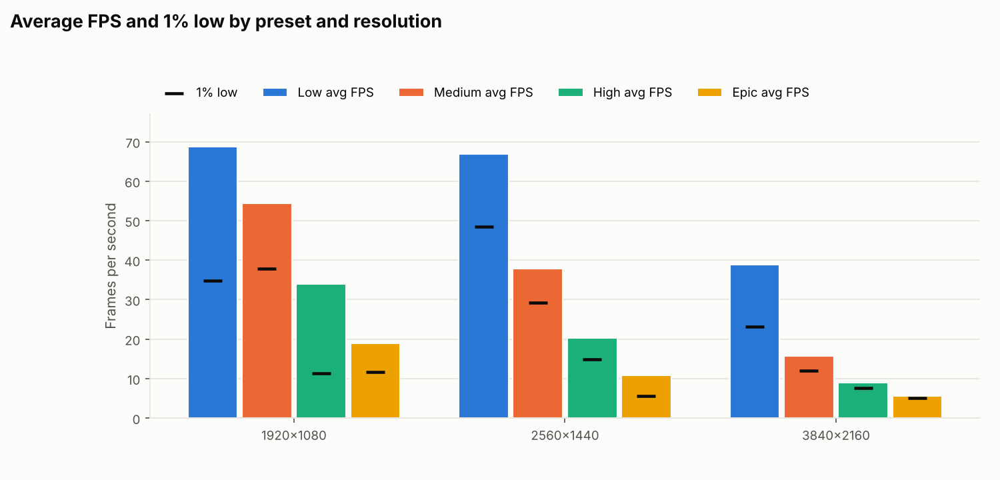
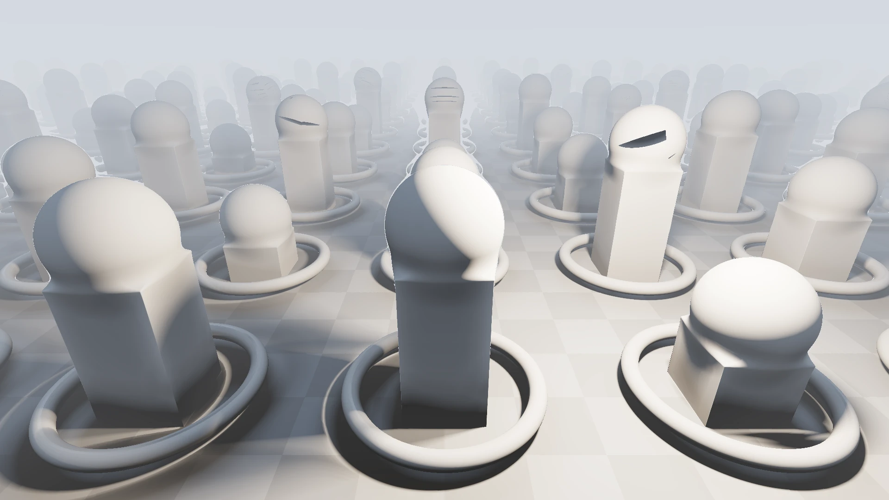
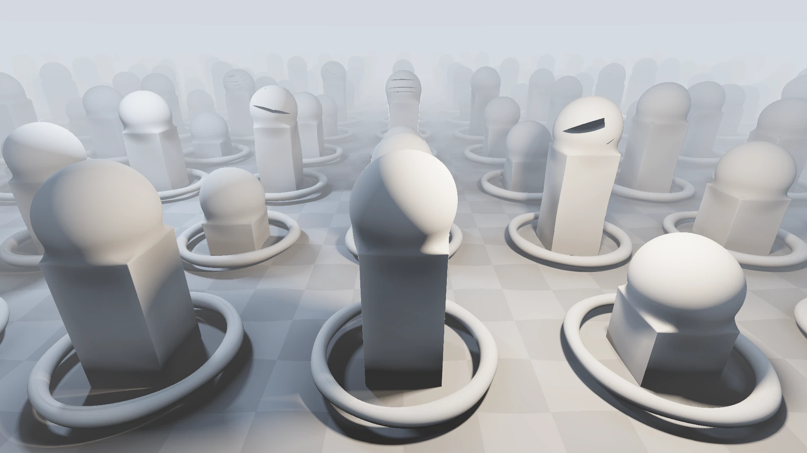
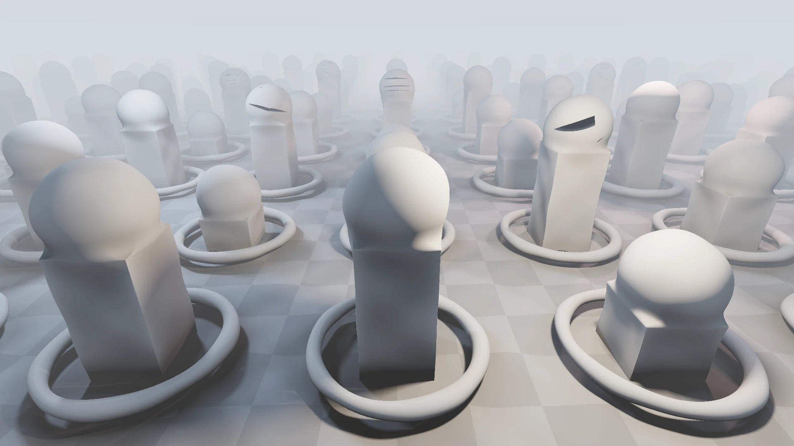
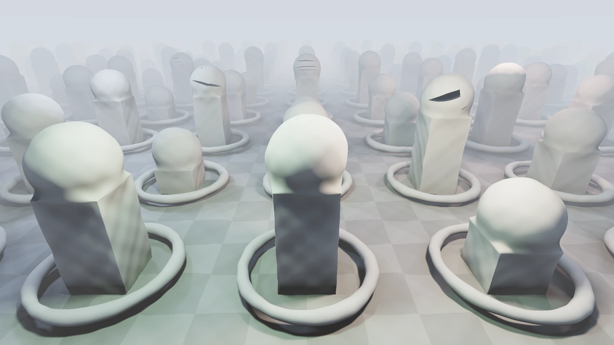
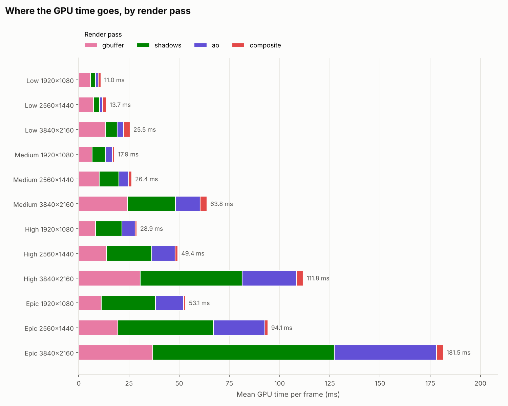
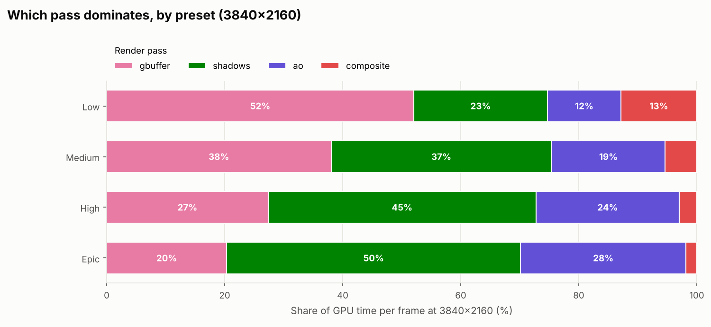
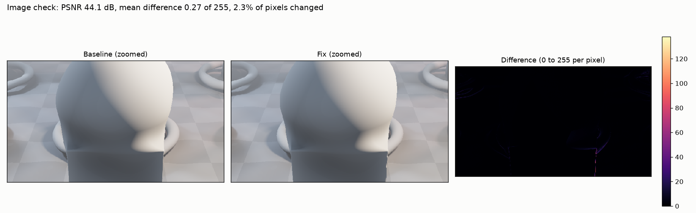

# Lab Report: How Graphics Settings Change GPU Work on an Apple M3

**Experiments:** `metal_scalability` (36 runs) and `metal_shadow_fix` (10 runs), Phases 2b and 5 of Game Frame Lab
**Date run:** November 18, 2026
**Hardware:** Apple M3 MacBook Air (fanless), macOS 26.5.1
**Operator:** Jackson Montgomery
**Status:** Complete. 46 of 46 runs captured and analyzed. All numbers in this report are real measurements.

---

## Summary

I wrote a small 3D renderer for the Mac, ran it at 4 quality settings and 3 screen sizes (12 combinations, 3 runs of each, 36 runs in total), and measured how long every frame took and how much of that time each step of the rendering took on the graphics chip. Then I used those measurements to pick one targeted fix and tested it before and after (10 more runs).

Four findings:

1. **The most expensive step changes with the quality setting.** At Low, finding the surfaces in the scene takes about half of the graphics chip's time. From High upward, drawing shadows takes the most, about half the time at Epic. This split barely changes with screen size.
2. **Once the graphics chip is the limit, work grows in step with the number of pixels.** Going from 2560x1440 to 3840x2160 at High means 2.25 times as many pixels, and each frame took 2.26 times as long.
3. **Epic costs about 7 times as much graphics work per frame as Low** (182 ms vs 26 ms per frame at 3840x2160).
4. **One targeted fix cut frame time by 16.8 ms (34%).** Drawing the shadows at half resolution took High 2560x1440 from 50.0 ms to 33.2 ms per frame (20.0 to 30.1 FPS). The saving came almost entirely from the shadow step, as predicted before the test, and the image barely changed.

The data also shows the limits of measuring on a fanless laptop: 4 of the 12 combinations varied by more than 5% from run to run, partly because the chip slows down as it heats up.



---

## 1. Background: the ideas you need

**Frame.** A game or 3D program shows motion by drawing a new still picture many times a second. Each picture is a frame.

**Frame time and FPS.** Frame time is how long one frame takes, in milliseconds (ms). Frames per second (FPS) is how many frames are drawn each second. They are two views of the same thing: 1000 divided by the frame time gives the FPS. A frame time of 16.7 ms is 60 FPS; 33.3 ms is 30 FPS. This report uses both, because frame time is easier to add up ("this step costs 5 ms") and FPS is easier to picture.

**GPU.** The graphics processing unit is the part of the chip that does the drawing. On the M3, the GPU sits on the same chip as the main processor (CPU) and shares its memory.

**Bottleneck and "GPU-bound".** A frame is only finished when every part of the computer has done its share. Whichever part is slowest sets the pace. When the GPU is the slowest part, the program is GPU-bound. Here that is measured as GPU busy %: the share of each frame's time the GPU spent working. Close to 100% means GPU-bound.

**Render pass.** Drawing one frame happens in steps, and each step is a render pass. The renderer used here has four (section 2).

**Resolution.** The number of pixels in each frame. This experiment used 1920x1080 (about 2.1 million pixels), 2560x1440 (3.7 million) and 3840x2160 (8.3 million, often called 4K).

**Preset.** A bundle of quality settings: Low, Medium, High, Epic. Higher presets make each pixel more expensive to compute, in exchange for a better looking image.

**1% low.** Average FPS hides hiccups. The 1% low is the average FPS of the slowest 1% of frames, so it shows how bad the worst moments feel.

**Stutter.** Here, any frame that took more than twice as long as a typical frame from the same run.

**95% confidence interval.** Repeated runs never give exactly the same number. A 95% confidence interval is the range the true value very likely falls in, given how much the runs disagreed. If a before/after difference has an interval that does not include zero, the change is real and not just run-to-run noise.

**Run-to-run variation (CV).** Each combination was run 3 times. The coefficient of variation (CV) says how much the 3 results disagree, as a percentage of their average. Under 2% is very consistent; above 5% means that result should be treated with caution.

**Thermal throttling.** When a chip gets hot, it lowers its own speed to protect itself. A MacBook Air has no fan, so under long, heavy work it gets slower over time.

---

## 2. The question and the setup

**Question:** How much GPU work do the quality presets and the resolution cost on an Apple M3, and which part of the drawing is responsible?

### The renderer: gflbench

Instead of using an existing game, I wrote a small renderer, **gflbench**, in Swift using Apple's Metal graphics interface. A game hides its internals; this renderer lets every setting be a known amount of work, and it times each of its own steps.

The scene is a camera circling over a ground plane covered with pillars, domes and rings, lit by moving lights. Everything is drawn by ray marching: for each pixel, the program steps a ray forward from the camera until it hits a surface. Every effect costs a known number of these steps.

Each frame is drawn in four render passes:

| Pass | What it does | Gets more expensive with |
|---|---|---|
| gbuffer | Sends one ray per pixel to find the first surface: its position, distance and direction | More ray steps, more surface detail |
| shadows | From each surface point, sends a ray toward every light to see if something blocks it | More lights, more steps per shadow ray |
| ao (ambient occlusion) | Checks how enclosed each point is, to darken corners and crevices | More sample directions and steps |
| composite | Combines lighting, shadows and occlusion into the final colors | Resolution only |

### What the presets change

| Preset | Ray steps | Lights | Steps per shadow ray | Occlusion samples (directions x steps) | Surface detail layers |
|---|---:|---:|---:|---:|---:|
| Low | 64 | 1 | 16 | 2 x 3 | 0 |
| Medium | 96 | 2 | 24 | 4 x 4 | 1 |
| High | 128 | 3 | 32 | 6 x 5 | 2 |
| Epic | 192 | 4 | 48 | 8 x 6 | 3 |

These values were chosen as a plausible quality ladder before any measurement. Which pass dominates is a property of these choices and of this GPU; it was measured, not assumed.

### What each preset looks like

The same moment of the camera path (5 seconds in), rendered by the benchmark itself at 1920x1080 on the M3 with its still-image mode (`gflbench --still`). These are compressed copies of the original PNGs.

| Low | Medium |
|---|---|
|  |  |
| **High** | **Epic** |
|  |  |

What to look for:

- **Shadows.** Low has one light, so every shadow points the same way and has a crisp edge. Each step up adds a light, so shadows overlap and soften. This is the shadow pass's extra work made visible.
- **Surfaces.** Low and Medium surfaces are smooth. High and especially Epic add layers of fine bumps (the "detail layers" in the table above), which is why Epic's pillars look rougher and mottled.
- **Corners and contact.** Ambient occlusion darkens where objects meet the ground and each other. It gets more samples at each preset, so these darkened areas get smoother.
- **A rendering bug, at every preset.** Some domes show thin dark slits or stripes (the dome right of center, and several in the distance). They most likely come from how the scene repeats one set of objects across a grid: when a ray passes close to the edge of one grid cell, the program only checks that cell's objects and can step into the neighboring cell's object. Because it affects every preset alike, it does not change the comparisons in this report, but it is a flaw in the renderer and is listed under next steps.

### Hardware and software

- Apple M3 MacBook Air with passive (fanless) cooling, macOS 26.5.1, plugged in.
- gflbench (Swift and Metal), built with the Xcode command line tools.
- The Game Frame Lab Python toolkit to run the experiment and analyze the logs.

---

## 3. Method

1. **12 combinations:** 4 presets x 3 resolutions.
2. **3 runs of each**, 60 seconds per run, for 36 runs. Repeating each run shows whether a result is stable.
3. **Warmup removed:** the first 10 seconds of every run were thrown away, so start-up effects do not count. Each result covers the same 50 seconds.
4. **Cooldown:** a 15 second pause between runs.
5. **Display sync off:** frames were not held back to match the screen's refresh rate, so frame times show the real cost of each frame.

**What was recorded for every frame:**

- **Frame time:** the time between one finished frame being handed to the display and the next.
- **GPU time per pass:** each pass was submitted to the GPU separately, and Metal reports when the GPU started and finished each one. This gives a per-pass breakdown on every single frame, which is the same question a professional GPU profiler answers.
- **Memory:** how much memory the renderer had allocated through Metal.

**How results were combined:** metrics were computed for each run, then averaged over that combination's 3 runs. Average FPS is frames divided by time, not an average of per-frame FPS (that would overstate performance).

---

## 4. Results

### 4.1 Frame rate for every combination

| Preset | Resolution | Avg FPS | Frame time (ms) | 1% low FPS | GPU busy % | Run CV % |
|---|---|---:|---:|---:|---:|---:|
| Low | 1920x1080 | 68.8 | 14.5 | 34.8 | 74.8 | 9.85 |
| Low | 2560x1440 | 66.9 | 14.9 | 48.5 | 90.6 | 17.20 |
| Low | 3840x2160 | 38.9 | 25.7 | 23.1 | 99.3 | 1.93 |
| Medium | 1920x1080 | 54.3 | 18.4 | 37.8 | 96.3 | 9.28 |
| Medium | 2560x1440 | 37.9 | 26.4 | 29.2 | 100.0 | 0.56 |
| Medium | 3840x2160 | 15.7 | 63.8 | 12.0 | 100.0 | 1.07 |
| High | 1920x1080 | 34.0 | 29.5 | 11.3 | 98.2 | 1.01 |
| High | 2560x1440 | 20.2 | 49.4 | 14.9 | 100.0 | 0.02 |
| High | 3840x2160 | 9.0 | 111.5 | 7.6 | 100.1 | 5.75 |
| Epic | 1920x1080 | 18.9 | 53.0 | 11.6 | 100.0 | 6.11 |
| Epic | 2560x1440 | 10.8 | 92.2 | 5.5 | 100.5 | 14.31 |
| Epic | 3840x2160 | 5.5 | 181.5 | 5.0 | 100.0 | 0.14 |

The GPU was the bottleneck (95% busy or more) in 10 of the 12 combinations. The exceptions are Low at 1920x1080 and 2560x1440 (section 4.4).

### 4.2 Where the GPU time goes



In 9 of the 10 GPU-bound combinations, the four passes add up to the measured frame time to within 1%. That agreement is a check that the per-pass timing is complete: no GPU work is missing from the breakdown. The exception, Epic at 2560x1440, is off by 2%; it is also the least repeatable combination (section 4.6).

### 4.3 Low vs Medium vs High vs Epic

At 3840x2160, every preset is fully GPU-bound, so this is the cleanest comparison:

| Preset | Frame time | Cost vs Low | Biggest pass |
|---|---:|---:|---|
| Low | 25.7 ms | 1.0x | gbuffer, 52% |
| Medium | 63.8 ms | 2.5x | gbuffer 38% and shadows 37%, nearly tied |
| High | 111.5 ms | 4.3x | shadows, 45% |
| Epic | 181.5 ms | 7.1x | shadows, 50% |



**What happens as the preset goes up:**

- **Low:** one light and short shadow rays make shadows cheap. Finding the surfaces (gbuffer) is half of all the work.
- **Medium:** a second light and longer shadow rays make shadows about as expensive as finding the surfaces.
- **High and Epic:** each step up doubles the shadow work (lights x steps per ray goes 48, 96, 192). Shadow time at 3840x2160 grew by 2.1x from Medium to High and by 1.8x from High to Epic, so shadows end up as half of every frame at Epic. Ambient occlusion also grows, from 12% to 28%.
- **Composite** cost depends only on resolution (0.9 to 1.2 ms at 1920x1080, 1.5 to 1.7 ms at 2560x1440, 3.3 to 3.4 ms at 3840x2160, whatever the preset), which is what its design predicts.

**The split depends on the preset, not the resolution.** At Epic, shadows are 51%, 50% and 50% of GPU time at the three resolutions; at Low, gbuffer is 52%, 53% and 52%. Charts for the other two resolutions: [1920x1080](figures/m3_pass_share_1920x1080.png), [2560x1440](figures/m3_pass_share_2560x1440.png).

### 4.4 Resolution: cost follows the pixel count once the GPU is the limit

| Change | Pixels | Frame time |
|---|---:|---:|
| High, 2560x1440 to 3840x2160 | 2.25x more | 2.26x longer |
| Medium, 2560x1440 to 3840x2160 | 2.25x more | 2.42x longer |
| High, 1920x1080 to 2560x1440 | 1.78x more | 1.68x longer |

Because every pass does its work per pixel, a GPU-bound frame should take about as much longer as it has more pixels, and it does.

**The exception is Low at the two smaller sizes.** Low at 1920x1080 ran at 68.8 FPS and Low at 2560x1440 at 66.9 FPS, almost the same even though the second has 78% more pixels. At 1920x1080 the GPU finished its work in 11.0 ms but frames arrived every 14.5 ms, so the GPU sat idle a quarter of the time. Something other than the GPU set the pace there. The likely candidate is how macOS paces frames for a window on screen, but this experiment did not test that, so it remains an open question.

### 4.5 Memory: a check on the tool

The renderer keeps four full-screen working images (34 bytes per pixel together), and the window keeps three display images (12 bytes per pixel together): 46 bytes per pixel in total. That predicts the memory use from the resolution alone:

| Resolution | Predicted | Measured (typical) |
|---|---:|---:|
| 1920x1080 | 91 MiB | 100 MiB |
| 2560x1440 | 162 MiB | 162 MiB |
| 3840x2160 | 364 MiB | 366 MiB |

The match shows that the memory measurement works and that this renderer's memory is almost entirely its working images. A few combinations peaked about 30 MiB higher (Low at 3840x2160, Epic at 2560x1440, High at 1920x1080), probably a temporary extra allocation. This was not investigated.

### 4.6 Repeatability and heat

Seven combinations repeated within 2% (High at 2560x1440 within 0.02%). Four did not:

| Combination | Run CV | Frames written in runs 1, 2, 3 (including warmup) |
|---|---:|---|
| Low 2560x1440 | 17.2% | 3630, 4626, 3632 |
| Epic 2560x1440 | 14.3% | 711, 574, 655 |
| Low 1920x1080 | 9.9% | 4444, 4105, 3944 |
| Medium 1920x1080 | 9.3% | 3198, 2999, 3590 |

Two different patterns show up. In some combinations each run was slower than the one before (Low 1920x1080 above; also High 3840x2160 at 563, 556, 504 and Epic 1920x1080 at 1196, 1150, 1061). A steady decline like that is the signature of thermal throttling on a fanless laptop. Others jump up or down without a trend (Low 2560x1440, Medium 1920x1080), which heat does not explain. The rows with CV above 5% should not be quoted as precise values until they are re-measured.

The heaviest combinations also showed many stutters: 14.8 per minute at Epic 1920x1080 and 23.7 per minute at Epic 2560x1440. Possible causes are the chip changing speed as it heats, or the camera passing through heavier parts of the scene. The per-frame timeline would tell them apart; that analysis is still to do.

---

## 5. Experiment 2: a targeted fix for the shadow step

### Why this fix

Section 4.3 showed that at High and Epic, the shadow pass takes the largest share of GPU time (45% and 50%). Section 4.4 showed that GPU work follows the pixel count. Put together, that suggests a fix: **compute the shadows at a lower resolution.** Shadows are soft and change slowly across the screen, so computing them for fewer pixels and filling in the gaps should lose little detail.

### What changed

With the fix, the shadow pass works at half the width and half the height (1280x720 instead of 2560x1440), which is a quarter of the pixels. The composite step then upsamples it: each full-size pixel blends the four nearest shadow values, giving more weight to the ones at a similar distance from the camera, so a shadow does not bleed across the edge of an object. Everything else is unchanged. The renderer turns this on with `--shadows-scale 0.5`.

### Method

- **Where:** High at 2560x1440. It was the most repeatable combination in experiment 1 (run-to-run variation 0.02%) and fully limited by the GPU, so even a small change would be measurable.
- **Runs:** 5 baseline runs (shadows at full resolution) and 5 fix runs, 60 seconds each, first 10 seconds dropped.
- **Alternating order:** baseline 1, fix 1, baseline 2, fix 2, and so on, with 60 second pauses. The MacBook Air warms up during a session (section 4.6); alternating makes any slowdown hit both versions equally instead of making whichever ran last look worse.
- **Statistics:** each run gives one value per metric; the change between the two versions comes with a 95% confidence interval.
- **Prediction, written down before the runs:** the shadow pass cost 22.5 ms of a 49.4 ms frame. If it scales with pixel count, a quarter of the pixels should save up to about 17 ms (three quarters of 22.5 ms), minus the cost of upsampling.

### Results

| Measurement | Baseline | Fix | Change | 95% interval of the change |
|---|---:|---:|---:|---:|
| Mean frame time | 50.03 ms | 33.21 ms | **-16.82 ms (-33.6%)** | -17.99 to -15.64 ms |
| Average FPS | 19.99 | 30.11 | +10.12 (+50.6%) | +9.67 to +10.57 |
| 1% low FPS | 14.56 | 24.35 | +9.78 (+67.2%) | +2.77 to +16.80 |
| p99 frame time | 57.27 ms | 37.95 ms | -19.31 ms (-33.7%) | -26.79 to -11.83 ms |
| GPU: gbuffer pass | 14.01 ms | 13.95 ms | -0.05 ms | -0.40 to +0.29 ms |
| GPU: shadows pass | 22.65 ms | 6.26 ms | **-16.40 ms (-72.4%)** | -16.56 to -16.24 ms |
| GPU: ao pass | 11.64 ms | 11.68 ms | +0.04 ms | -0.03 to +0.12 ms |
| GPU: composite pass | 1.48 ms | 1.32 ms | -0.17 ms | -0.22 to -0.12 ms |

What the table shows:

- **The fix is real and large.** Frame time fell by 16.8 ms, and the whole 95% interval (15.6 to 18.0 ms) is far from zero.
- **The prediction held.** The shadow pass saved 16.4 ms, close to the "up to about 17 ms" predicted. It dropped by 72%, a little short of the 75% that a perfectly proportional saving on a quarter of the pixels would give.
- **Only the targeted step changed.** The gbuffer and ao intervals include zero, so those passes did not change. The composite step, which now also does the upsampling, did not get slower; it got 0.17 ms faster, possibly because it reads a smaller shadow image.
- **Why 34% faster frames mean 51% more FPS.** FPS is 1000 divided by frame time, so cutting frame time by a third raises FPS by half (1 / (1 - 0.336) = 1.506). Frame time is the fairer way to state a saving, which is why this report leads with it.
- **The baseline reproduced experiment 1.** Baseline High 2560x1440 averaged 50.03 ms per frame here and 49.41 ms in experiment 1, a 1.3% difference between two separate sessions.

### Did the image suffer?

A speedup only counts as a fix if the picture still looks right. The renderer saved the exact same view (same camera position) with and without the fix, and a script compared them pixel by pixel:

| Image check | Value |
|---|---:|
| PSNR (higher means more alike; above about 40 dB differences are hard to see) | 44.1 dB |
| Average difference per pixel | 0.27 out of 255 |
| Pixels that changed by more than a trace (2 or more levels out of 255) | 2.3% |
| Largest single difference | 138 out of 255 |

Overall the two images are nearly identical, but the largest difference shows that a small number of pixels change a lot. The comparison image shows where:



The differences sit along **object outlines**, not across the shadows themselves: a thin, stair-stepped line down the edges of the center pillar (where the largest difference, 138 out of 255, occurs) and fainter lines around the rings. Where a near object meets the far background, some of the quarter-resolution shadow samples come from the wrong side of the edge, and the depth-aware filter does not catch every one. Inside surfaces and across the floor, the two images match.

The full frames, same view, baseline then fix (compressed copies of the PNGs the renderer saved):

| Baseline: shadows at full resolution | Fix: shadows at half resolution |
|---|---|
|  |  |

### Verdict

Rendering shadows at half resolution is a strong fix at High 2560x1440 on this hardware: one third off every frame, with 98% of pixels essentially unchanged. Its one visible cost is a thin stair-stepped line along some object outlines. It is subtle in a still frame, but edges like this tend to shimmer when the camera moves, so a better filter at depth edges is the next refinement.

---

## 6. Discussion

The main result is that **there is no single bottleneck to fix; it depends on the setting.** At Low, the cheapest win would be to make the surface-finding pass faster. At High and Epic, the shadow pass is where half the time goes, and improving anything else could save at most the other half. This is why measuring each pass matters more than measuring the whole frame: a frame-rate number alone could not have shown this.

The second result is a sanity check that also matters for planning: once the GPU is the bottleneck, cost follows pixel count closely. Rendering a pass at a lower resolution should save roughly in proportion to the pixels removed. Experiment 2 (section 5) tested exactly that and confirmed it: a quarter of the shadow pixels cost 28% of the shadow time.

Together, the two experiments show a complete optimization loop: measure where the time goes, pick the biggest target, predict the saving, test it with alternating runs and a confidence interval, and check the image.

### Limitations

- **One machine, one scene, presets I chose.** The results describe this renderer on this M3. A different scene or different preset values would split the time differently.
- **Fanless laptop.** Heat affected some runs (section 4.6). The four noisy combinations need re-runs with longer cooldowns.
- **Window, not full screen.** The renderer ran in a window, so macOS's window compositor was involved in showing frames. That may be why the Low settings at small resolutions are not GPU-bound.
- **GPU busy slightly above 100%** in a few rows (up to 100.5%). The per-pass timestamps overlap a little at their edges. These rows should be read as fully GPU-bound.
- **Few frames in the slowest 0.1%.** The heavy settings produce only a few hundred frames per run, so the 0.1% low rests on one or two frames and is not used in this report.
- **One fix, one setting.** The shadow fix was tested only at High 2560x1440. Its saving at other presets and resolutions is expected to follow the shadow pass's share of the frame, but that was not measured.
- **Image check from one view.** The image comparison uses one camera position; other views could show more or fewer edge differences, and a still image cannot show shimmer in motion.
- **Rendering artifact.** The renderer draws thin dark slits on some objects (section 2, "What each preset looks like"). Fixing it means checking neighboring grid cells, which adds work to every distance check, so all timings would need to be measured again afterwards.
- **Values in this report** come from the output of `gfl analyze` and `gfl compare` on the capture Mac (see [the scalability data](../results/metal_scalability/summary_apple_m3_2026-11-18.csv) and [the fix comparison](../results/metal_shadow_fix/comparison_apple_m3_2026-11-18.csv)). The raw per-frame logs stay on that Mac.

---

## 7. Conclusions

1. On the Apple M3, gflbench is GPU-bound in 10 of 12 combinations; Low at the two smaller resolutions is limited by something else.
2. The pass that dominates changes with the preset: surface finding at Low, shadows at High and Epic (half of all GPU time at Epic). The split is nearly the same at every resolution.
3. GPU-bound frame time grows in proportion to pixel count (2.26x longer for 2.25x the pixels at High).
4. Epic costs 7.1 times as much GPU time per frame as Low at 3840x2160.
5. Memory use matches the renderer's working images to within 1% at the two larger resolutions, which validates the measurement.
6. A fanless laptop adds run-to-run variation; 4 of 12 combinations need re-measurement before their numbers are quoted.
7. Rendering shadows at half resolution cut frame time by 16.8 ms (33.6%, 95% interval 15.6 to 18.0 ms) at High 2560x1440, as predicted from the per-pass measurements, with an image PSNR of 44 dB.

---

## 8. Next steps

1. **Clean up the object outlines in the shadow fix.** Improve the upsampling filter at depth edges (for example, take the shadow from the single neighbor closest in depth when the four disagree), then repeat the timing comparison and the image check.
2. **Fix the dark-slit rendering bug** by checking the neighboring grid cells, then re-measure, since the fix adds work to every pass.
3. **Re-run the four noisy combinations** with a 60 second cooldown, to separate heat from other variation.
4. **Investigate the Low ceiling** at about 68 FPS: run full screen and with display sync on and off.
5. **Analyze the per-frame timeline** of the Epic runs to explain the stutters.
6. **The NVIDIA part of the study** (Unreal Engine 5, DLSS, AI inference load) still needs a Windows PC with an NVIDIA RTX GPU.

---

## Appendix A: How to reproduce

On an Apple silicon Mac with Python 3.11 or newer and the Xcode command line tools:

```bash
git clone https://github.com/MoneyMont1738/game-frame-lab.git && cd game-frame-lab
```

```bash
python3 -m venv .venv && source .venv/bin/activate && pip install -e ".[dev]"
```

```bash
bash bench/metal/build.sh
```

```bash
gfl run configs/metal_scalability.yaml
```

```bash
gfl analyze data/raw/<capture folder printed by gfl run>
```

Experiment 2 (about 20 minutes), then the comparison and the image check:

```bash
gfl run configs/metal_shadow_fix.yaml
```

```bash
gfl compare data/raw/<capture folder printed by gfl run>
```

```bash
bench/metal/gflbench --preset high --resolution 2560x1440 --scene-time 5 --still reports/figures/m3_shadowfix_baseline.png
```

```bash
bench/metal/gflbench --preset high --resolution 2560x1440 --scene-time 5 --shadows-scale 0.5 --still reports/figures/m3_shadowfix_fix.png
```

```bash
python scripts/compare_stills.py reports/figures/m3_shadowfix_baseline.png reports/figures/m3_shadowfix_fix.png reports/figures/m3_shadowfix_image_check.png
```

The charts in this report were drawn from the summary data with:

```bash
python scripts/plot_summary.py results/metal_scalability/summary_apple_m3_2026-11-18.csv reports/figures --prefix m3_
```

## Appendix B: Full per-pass GPU time (ms per frame)

| Preset | Resolution | gbuffer | shadows | ao | composite | Total |
|---|---|---:|---:|---:|---:|---:|
| Low | 1920x1080 | 5.75 | 2.52 | 1.49 | 1.23 | 10.99 |
| Low | 2560x1440 | 7.30 | 2.99 | 1.67 | 1.74 | 13.70 |
| Low | 3840x2160 | 13.29 | 5.79 | 3.18 | 3.28 | 25.54 |
| Medium | 1920x1080 | 6.67 | 6.62 | 3.46 | 1.10 | 17.85 |
| Medium | 2560x1440 | 10.22 | 9.79 | 4.89 | 1.48 | 26.38 |
| Medium | 3840x2160 | 24.28 | 23.85 | 12.30 | 3.41 | 63.84 |
| High | 1920x1080 | 8.27 | 13.22 | 6.60 | 0.85 | 28.94 |
| High | 2560x1440 | 13.81 | 22.52 | 11.59 | 1.46 | 49.38 |
| High | 3840x2160 | 30.60 | 50.73 | 27.17 | 3.30 | 111.80 |
| Epic | 1920x1080 | 11.22 | 27.02 | 14.03 | 0.87 | 53.14 |
| Epic | 2560x1440 | 19.55 | 47.46 | 25.59 | 1.53 | 94.13 |
| Epic | 3840x2160 | 36.91 | 90.33 | 50.94 | 3.28 | 181.46 |
